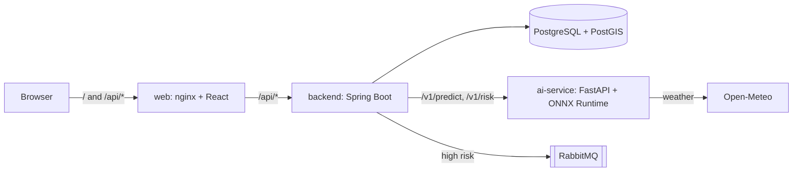

# Rootine

Rootine helps farmers find plant diseases early. Farmers draw their parcels on a map, upload photos of leaves and get a diagnosis from an ML model. They also see a map of weather-based disease risk and get alerts when the risk is high.

## The problem

Plant diseases are easy to miss at the start and expensive to fix late. Farmers need a quick way to check a leaf, and an early warning when the weather makes a disease likely on their land.

## Main features

- Draw and manage parcels on a map.
- Upload a leaf photo and get a diagnosis (top 3 predictions).
- Weather-based disease risk map (heatmap) for all parcels.
- Alerts by email and live in the app when the risk is high.
- All crops in the long run. Demo 1 covers only tomato and potato.

## Architecture

More details: [docs/architecture/overview.md](docs/architecture/overview.md).

## Tech stack

| Part | Stack |
|---|---|
| Frontend | React, TypeScript, Vite, TanStack Query, Zustand, Leaflet, Vitest |
| Backend | Java 21, Spring Boot 4, PostgreSQL with PostGIS, Flyway, RabbitMQ, JWT |
| AI | Python 3.11, FastAPI, ONNX Runtime (MobileNetV3-Large), Open-Meteo, pytest |
| Infra | Docker Compose, nginx, GitHub Actions |

## Team

Team **Work in Progress (WIP)**, 8 people.

| Part | Members (GitHub) |
|---|---|
| Frontend | Beatrice ([@BeatriceChirila](https://github.com/BeatriceChirila)), Ariana ([@CioataAriana](https://github.com/CioataAriana)) |
| Backend | Alex Vacaru ([@Alecs06](https://github.com/Alecs06), representative), Alex U ([@AlexU05](https://github.com/AlexU05)), Violeta ([@VioletaUngureanu](https://github.com/VioletaUngureanu)) |
| AI | Darius ([@DariusTurcu22](https://github.com/DariusTurcu22), team lead and representative), Maia ([@tapordeimaia](https://github.com/tapordeimaia), Scrum Master), Andreea ([@deea-andreea](https://github.com/deea-andreea)) |

## Course

Proiect Colectiv, Babeș-Bolyai University (UBB), Faculty of Mathematics and Computer Science, 2026-27.

## Status and dates

The project is at the start: the repository, CI and a working skeleton of the three parts exist. No features yet.

| Date | Milestone |
|---|---|
| Wed 4 Nov 2026 | Mentor meeting |
| Fri 13 Nov 2026 | Demo 1 |
| Sat 12 Dec 2026 | Demo 2 |
| 16-17 Jan 2027 | Final evaluation |

## Links

- [SETUP.md](SETUP.md): how to install and run everything
- [CONTRIBUTING.md](CONTRIBUTING.md): how we work (branches, commits, PRs)
- [docs/](docs/README.md): architecture, decisions, API contract, sprints, meetings
