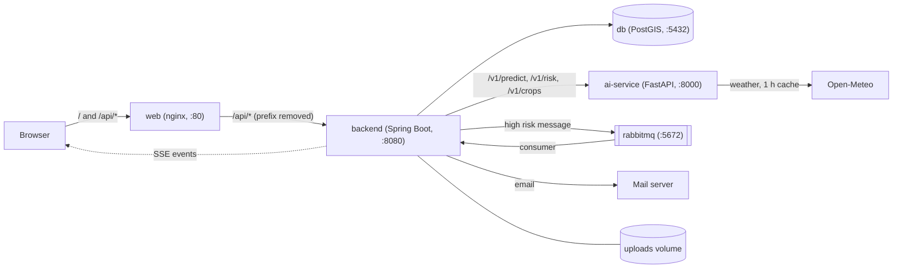

# Architecture overview

Rootine has three parts in one repository: `frontend/`, `backend/` and `ai-service/`. `docker-compose.yml` runs them together with a database and a message broker.

## Components

| Component | Technology | Port | Role |
|---|---|---|---|
| `web` | nginx with the built React app | 80 | Serves the app on `/` and forwards `/api/*` to the backend |
| `backend` | Java 21, Spring Boot 4 | 8080 | REST API, auth, parcels, diagnoses, daily risk job, alerts |
| `ai-service` | Python 3.11, FastAPI, ONNX Runtime | 8000 | Image diagnosis and weather-based disease risk |
| `db` | PostgreSQL with PostGIS | 5432 | Users, parcels (geometries), diagnoses, risk results |
| `rabbitmq` | RabbitMQ with management UI | 5672, 15672 | Alert messages between the daily job and the alert consumer |

## How the parts talk

- The browser only talks to `web`. `/` returns the React app. `/api/*` is forwarded to the backend (nginx removes the `/api` prefix). The live alert stream (SSE) also goes through `/api`; nginx has proxy buffering off for it.
- The AI service is internal. Only the backend calls it: `/v1/predict`, `/v1/risk`, `/v1/crops`.
- The AI service gets weather from Open-Meteo itself (1-hour cache) and computes disease risk with published rule models. There is no ML on weather. The backend has no weather module.
- Uploaded photos are saved on the Docker volume `uploads`. The database stores only the file path.

## Daily risk job and alerts

1. Once a day the backend goes through all parcels.
2. For each parcel it calls the AI service `POST /v1/risk` and stores the result. The stored results feed the heatmap endpoints.
3. If the risk is high, the backend publishes a message to RabbitMQ.
4. A consumer reads the message, sends an email and pushes an SSE event to the user's open app.

## Diagnosis flow

1. The farmer uploads a leaf photo for a parcel.
2. The backend saves the file, then calls the AI service `POST /v1/predict` with the image and the parcel's crop.
3. The AI service returns the top 3 predictions and a status. The backend stores the result and returns it.

## Diagram

## Models

One image model (MobileNetV3-Large) serves all crops. The crop of the parcel is used as a mask over the classes. The classes are read from `ai-service/models/plant-v1/labels.csv`, never hardcoded. Model files are not in Git; see [ADR 0008](../decisions/0008-models-in-github-releases.md).
